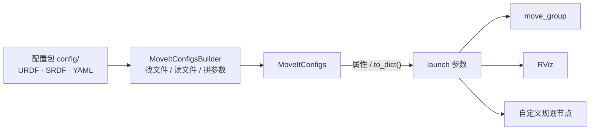

本文介绍 MoveIt 2 中的 `MoveItConfigsBuilder`。

`MoveItConfigsBuilder` 是 MoveIt 2 提供的一个 Python“配置打包器”。按照固定约定，读取一个 MoveIt 配置包中的若干 YAML / SRDF / xacro 文件，成为一个配置对象，从而方便在 launch 文件中使用，如传给 `move_group`、自定义规划节点或 RViz。下面是 `MoveItConfigsBuilder` 的工作和使用示意图：

# 一、为什么需要？
MoveIt 要控制一个机器人，需要若干配置：
- .xacro、.urdf：机器人长什么样
- srdf**哪些关节能一起动、哪些不能碰** → `SRDF`
- **逆运动学用哪个求解器** → `kinematics.yaml`
- **用哪个规划算法、参数多少** → `ompl_planning.yaml`
- **规划完交给哪个控制器执行** → `moveit_controllers.yaml`
- **关节速度 / 加速度限制** → `joint_limits.yaml`
- ……
这些文件通常放在一个名为 `<robot>_moveit_config` 的包里（本仓库是 `dual_ur5e_moveit_config/`）。
如果没有 `MoveItConfigsBuilder`，你得在 launch 文件里手写：
```python
parameters = [
    {"robot_description": open("/path/xxx.urdf").read()},
    {"robot_description_semantic": open("/path/xxx.srdf").read()},
    yaml.safe_load(open("/path/kinematics.yaml")),
    yaml.safe_load(open("/path/ompl_planning.yaml")),
    ...
]
```
路径写错、文件改名、少传一个参数，都会让 MoveIt 报错。`MoveItConfigsBuilder` 的作用，就是自动完成这些“重复劳动 + 路径拼接”。
# 二、默认读取的文件
构造时传入机器人名后，它会去配置包的 `config/` 目录下按默认文件名查找：

| 对应参数键 | 方法 | 默认文件 | 内容 |
| --- | --- | --- | --- |
| `robot_description` | .robot_description() | - 首先，找 config/<robot_name>.urdf.xacro；- 然后，根据 .setup_assistant 中的 package、relative_path；- 最后，找 config/<robot_name>.urdf | URDF XML 字符串，与下面共同构成 RobotModel。即机器人几何 / 关节模型 |
| `robot_description_semantic` | .robot_description_semantic() | `config/<robot>.srdf` | SRDF XML 字符串，与上面共同构成 RobotModel。规划组、允许碰撞对、初始位姿等语义信息 |
| `robot_description_kinematics` |  | `config/kinematics.yaml` | IK 求解器配置。可以对每个规划组配置 |
| `robot_description_planning` |  | - `config/joint_limits.yaml` - `config/pilz_cartesian_limits.yaml` | 关节限位/笛卡尔限位 |
| 1）顶层键：`planning_pipelines` <br>2）子层键：`default_planning_pipeline`、`planning_pipelines`、`xxx`、`yyy`（根据 planning_pipelines 指定内容） | .planning_pipelines() | - 首先，找  config/xxx_planning.yaml；- 然后，找  moveit_configs_utils/default_configs/xxx_planning.yaml ；- 都没有，报错 | OMPL 各规划组的参数 |
| `moveit_controllers` 等 |  | `config/moveit_controllers.yaml` | 执行轨迹时调用的控制器 |
| `pilz_cartesian_limits` |  | `config/pilz_cartesian_limits.yaml` | Pilz 规划器的笛卡尔限制 |
| `sensors_3d` |  | `config/sensors_3d.yaml` | 3D 传感器（点云）配置 |


# 三、使用
**第一步：构造**

```python
from moveit_configs_utils import MoveItConfigsBuilder

builder = MoveItConfigsBuilder(
    "dual_ur5e",                              # 机器人名（决定默认文件名）
    package_name="dual_ur5e_moveit_config",   # 配置包名
)
```

内部会用 ROS 2 的 `get_package_share_directory(package_name)` 找到包路径。需要注意的是：这个包必须已经被 `colcon build` 并 `source install/setup.bash`，否则会抛 `PackageNotFoundError`。

**第二步：按需覆盖默认文件（可选）**
默认约定不满足时，可以链式调用指定路径：

```python
from moveit_configs_utils import MoveItConfigsBuilder

moveit_config = MoveItConfigsBuilder("dual_ur5e", package_name="dual_ur5e_moveit_config")
    .robot_description(                                                     # URDF / xacro → robot_description
        file_path="config/dual_ur5e.urdf.xacro",
        mappings={"use_fake_hardware": "true"},
    )
    .robot_description_semantic(file_path="config/dual_ur5e.srdf")          # SRDF → robot_description_semantic
    .robot_description_kinematics(file_path="config/kinematics.yaml")       # IK 求解器 → robot_description_kinematics
    .joint_limits(file_path="config/joint_limits.yaml")                     # 关节限制 → robot_description_planning（注意方法名是 joint_limits）
    .pilz_cartesian_limits(file_path="config/pilz_cartesian_limits.yaml")   # Pilz 笛卡尔限制 → 合并进 robot_description_planning
    .trajectory_execution(file_path="config/moveit_controllers.yaml")       # 控制器 → moveit_controllers / moveit_simple_controller_manager 等
    .sensors_3d(file_path="config/sensors_3d.yaml")                         # 3D 传感器 → sensors_3d
    .planning_pipelines(                                                    # 规划管线：ompl_planning.yaml → 顶层 ompl 键 + planning_pipelines
        default_planning_pipeline="ompl",
        pipelines=["ompl"],
    )
    .to_moveit_configs()
```
**第三步：取出配置**

`to_moveit_configs()` 返回一个 `MoveItConfigs` 对象，有两种取用方式：

```python
# 按属性取（适合逐个传给节点）
moveit_config.robot_description             # {"robot_description": "..."}
moveit_config.robot_description_semantic    # {"robot_description_semantic": "..."}
moveit_config.robot_description_kinematics  # {...}
moveit_config.planning_pipelines            # {"planning_pipelines": {...}, "ompl": {...}}
moveit_config.package_path                  # 配置包的安装路径 Path

# 方式 B：转成扁平 dict（最适合自定义节点）
params = moveit_config.to_dict()
```