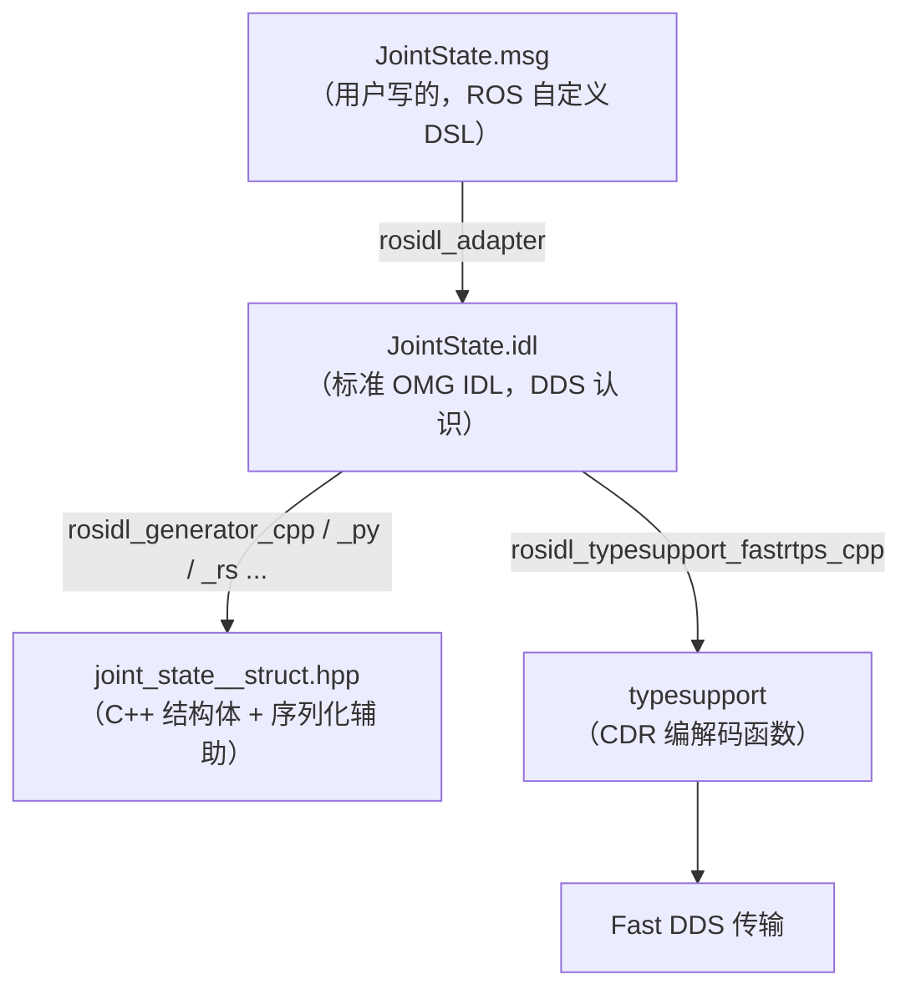

本文介绍 ROS 2 的三类接口类型。

# 一、主题（Topic）

> 主题建立在 DDS 之上：DDS 负责发现、序列化、传输和 QoS 执行，QoS 决定发布者与订阅者能否匹配，IDL 决定数据在链路上的样子。

主题一般用于传输连续数据流，如传感器数据。主题采用发布/订阅者模式，架构如下： 其中：
- 发布者（Publisher）指定发布的主题，向主题发送消息，订阅者（Subscriber）订阅主题，从主题消费消息；
- 同一主题可以关联若干发布者、订阅者；
- 发布者单向、异步发送消息；

发布者发布的消息、订阅者收到的消息格式定义在 .msg 文件中，消息包含键来标志发布者身份，进而区分发布者。


## 1. DDS
DDS（Data Distribution Service）是 OMG 组织制定的一个分布式实时发布 / 订阅中间件标准，不是 ROS 的一部分。它负责：

- **发现（Discovery）**：节点上线后自动找到彼此，不需要 `roscore` 这种中心节点；
- **序列化**：按 IDL 定义的格式（CDR 编码）把消息变成字节流；
- **传输**：基于 UDP（默认）/ TCP / 共享内存，支持多播；
- **QoS 执行**：按双方协商的 QoS 决定重传、丢弃、缓存、生命周期等行为。

常见实现（RMW 层可切换）：

| 实现 | 说明 |
| --- | --- |
| Fast DDS（eProsima） | ROS 2 Humble 的默认实现 |
| Cyclone DDS（Eclipse） | 延迟低、发现开销小，很多机器人厂商改用这个 |
| RTI Connext | 商业版，工业界常见 |
| OpenDDS / GurumDDS | 其他开源 / 商业实现 |

ROS 2 的通信栈大致是：

```mermaid
flowchart TD
    A["你的节点代码<br/>#include &lt;rclcpp/rclcpp.hpp&gt;"] -->|C++ 对象| B["rclcpp<br/>（C++ 客户端库）"]
    B --> C["rcl<br/>（C 接口，rcl_*）"]
    C --> D["rmw 抽象接口 ①<br/>（rmw_* 纯 C API，只有声明）<br/>rmw_create_publisher / rmw_publish / ..."]
    D -->|运行时 dlopen 选实现| E["rmw_implementation<br/>（动态派发 / 加载器）"]
    E --> F["rmw_fastrtps_cpp ②"]
    E --> G["rmw_cyclonedds_cpp ②"]
    F --> H["Fast DDS ③<br/>（libfastdds.so）"]
    G --> I["Cyclone DDS ③<br/>（libddsc.so）"]
    H --> J["RTPS over UDP / SHM / TCP"]
    I --> J
```



① 规范　② 适配器　③ DDS 实现

所以换 DDS 实现只要设环境变量，代码不用改：

```bash
export RMW_IMPLEMENTATION=rmw_cyclonedds_cpp
```

ROS 2 选择 DDS 的理由：

- 去中心化发现；
- 丰富的 QoS；
- 多家厂商可替换；
- 面向实时 / 嵌入式。

代价：

- 大型网络中发现流量大；
- 多网卡 / Jetson 上多播容易出问题；
- QoS 不匹配时静默不连通（这是新手最容易踩的坑）。

## 2. QoS
QoS（Quality of Service）是 DDS 实体上的一整套通信契约参数。每个端点创建时带一份 QoS 配置，DDS 只在发布者“提供”的 QoS 满足订阅者“请求”的 QoS 时才把它们连起来。DDS 用 RxO(Requested/Offered) 模型逐条策略比较：writer 提供的(Offered)某一策略,必须“不弱于”reader 请求的(Requested),两端才能匹配。
> DDS 实体 = DomainParticipant、Publisher、Subscriber、Topic、DataWriter、DataReader 的统称。端点 = 只有 DataWriter 和 DataReader。


Offered(writer)	Requested(reader)	匹配?
RELIABLE	RELIABLE	✅
RELIABLE	BEST_EFFORT	✅(提供得比要求更强)
BEST_EFFORT	RELIABLE	❌
durability 同理(TRANSIENT_LOCAL 能满足 VOLATILE,反之不行)。

4. 不是所有 QoS 都参与匹配
这是上一条关于 depth 的延伸,很重要:

类别	策略	参与 RxO 匹配?
RxO	reliability、durability、deadline、latency_budget、liveliness、ownership、destination_order、time_based_filter	✅ 影响能否连上
本地	history、depth、resource_limits、lifespan、transport_priority	❌ 只影响本地缓冲
所以:

merger depth=100 的 publisher 和 RSP depth=5 的 subscription 能正常匹配;
但 Isaac 若用 BEST_EFFORT 发、merger 用 RELIABLE 收,就匹配失败——前者是本地策略,后者是 RxO 策略。

ROS 2 暴露的常用 QoS 策略：

| 策略 | 作用 | 取值 |
| --- | --- | --- |
| `Reliability` | 丢包是否重传 | `RELIABLE`：重传和确认<br>`BEST_EFFORT`：发了不管 |
| `History` | 缓存策略，配合 `depth` | `KEEP_LAST(n)` / `KEEP_ALL` |
| `Durability` | `TRANSIENT_LOCAL` 类似 ROS 1 的 latched：后加入的订阅者能收到最后 N 条 | `VOLATILE` / `TRANSIENT_LOCAL` |
| `Deadline` | 承诺消息最大间隔，超时触发事件回调 | 时间 |
| `Lifespan` | 消息在 DDS 里存活多久，过期即丢弃 | 时间 |
| `Liveliness` | 检测对端是否还活着 | `AUTOMATIC` / `MANUAL_BY_TOPIC` + lease |

#### 匹配规则（核心）

DDS 按“请求 vs 提供”匹配，不兼容就不建立连接：

| 发布者提供 ＼ 订阅者请求 | `RELIABLE` | `BEST_EFFORT` |
| --- | :---: | :---: |
| `RELIABLE` | ✅ | ✅ |
| `BEST_EFFORT` | ❌ | ✅ |

`Durability` 同理：`VOLATILE` 发布者 ⇄ `TRANSIENT_LOCAL` 订阅者 ❌。

> **关键点**：不匹配不会报错。节点照常创建、话题照常出现在 `ros2 topic list` 里，只是数据永远不来。

排查时用：

```bash
ros2 topic info -v /ur5/joint_states     # 看两端的 QoS
ros2 doctor --report                     # 检查 RMW、网络
```

### 3. ROS 2 的 QoS 预设

`rclcpp` 把 DDS QoS 包装成了几个预设，覆盖 90% 场景：

| 预设 | Reliability | History / Depth | Durability | 适用 |
| --- | --- | --- | --- | --- |
| `rclcpp::QoS(10)`（默认） | `RELIABLE` | `KEEP_LAST(10)` | `VOLATILE` | 一般话题、控制指令 |
| `rclcpp::SystemDefaultsQoS()` | `RELIABLE` | `KEEP_LAST(10)` | `VOLATILE` | 同上 |
| `rclcpp::SensorDataQoS()` | `BEST_EFFORT` | `KEEP_LAST(5)` | `VOLATILE` | 高频传感器（相机、雷达），低延迟、允许丢帧 |
| `rclcpp::QoS(1).transient_local()` | `RELIABLE` | `KEEP_LAST(1)` | `TRANSIENT_LOCAL` | 静态地图、`robot_description` |

## 4. IDL

IDL（Interface Definition Language，接口定义语言）是一种只描述“数据长什么样、接口长什么样”、不含任何实现的声明式语言。首先用 IDL 定义类型和方法签名，再由代码生成器把它翻译成各具体语言的代码和二进制布局规则。

它不是 ROS 专有的概念：DDS、CORBA、gRPC、Thrift、Protobuf、Android AIDL 都属于这一类。

DDS 标准规定用 OMG IDL 来描述数据类型。ROS 2 为了对用户友好，上层的 `.msg` / `.srv` / `.action` 是自定义 DSL，构建时会被转换成标准 IDL，再由 IDL 生成各语言代码：



`sensor_msgs::msg::JointState` 就是这个链条末端的产物。

#### 一个真实例子

系统里装好的 `JointState.idl` 节选：

```idl
#include "std_msgs/msg/Header.idl"

module sensor_msgs {
  module msg {
    struct JointState {
      std_msgs::msg::Header header;
      sequence<string> name;
      sequence<double> position;
      sequence<double> velocity;
      sequence<double> effort;
    };
  };
};
```

对照一下 IDL 语法：

| IDL | 含义 | 对应 C++ |
| --- | --- | --- |
| `module` | 命名空间 | `namespace` |
| `struct` | 结构体 | `struct JointState` |
| `sequence<T>` | 变长数组 | `std::vector<T>` |
| `string` | 变长字符串 | `std::string` |
| `double` / `long` / `boolean` / `octet` | 基础类型 | `double` / `int32_t` / `bool` / `uint8_t` |
| `@verbatim` | 注解，这里用来塞注释 | — |
| `@key` | 标注主键（DDS 用于实例管理） | — |

生成的 C++ 结构体在 `/opt/ros/humble/include/sensor_msgs/sensor_msgs/msg/detail/joint_state__struct.hpp`：

```cpp
struct JointState_ {
  sensor_msgs::msg::Header_<ContainerAllocator> header;
  std::vector<std::string, ...> name;
  std::vector<double, ...> position;
  std::vector<double, ...> velocity;
  std::vector<double, ...> effort;
};
using JointState = JointState_<std::allocator<void>>;
```

这里的 `ContainerAllocator` 模板参数也是为了让实时 / 嵌入式场景可以塞自定义分配器。

#### 为什么 IDL 重要

- **语言与厂商中立**：C++、Python、Rust、Java 的节点，以及 Fast DDS / Cyclone DDS / RTI Connext 之间能互通，靠的就是大家遵循同一份 IDL 定义。
- **决定线格式（wire format）**：IDL 里的字段顺序、类型、对齐规则决定了 CDR（Common Data Representation）编码后的字节布局。这是二进制协议，不是 JSON——所以两个用同一 `.msg` 编译出来的节点才能互相解析。
- **类型检查**：ROS 2 会给每个类型算一个 `type hash`，DDS 层面还会做类型一致性检查。如果两边 `.msg` 定义不一致（比如一边多了个字段），轻则解析乱码，重则直接连不上。
- **内省（introspection）**：`rosidl_typesupport_introspection_cpp` 让 `ros2 topic echo`、`rosbag2`、`Foxglove` 这类工具不需要编译你的自定义消息也能动态解析——靠的就是 IDL 里的类型信息。

## 函数
### 1、create_wall_timer

1）功能：在节点上创建一个周期性定时器，定时器由节点的执行器（rclcpp::spin(node)）驱动，随节点一起销毁。
2）参数
- 第一个参数：周期。填入数值，单位ms；
- 第二个参数：回调。即，被执行函数；
- 第三个参数：回调组。执行器调度回调的基本单位，决定哪些回调可以同时执行、哪些必须互斥;
下面是
3）

### 回调组

1、**回调组类型**
回调组只有两种类型：MutuallyExclusive、Reentrant。区别如下：

类型	组内语义	组间语义
MutuallyExclusive	同一时刻最多一个回调在执行；回调不可重入	可与其他组并行
Reentrant	组内回调可以并发执行，同一个回调也可以同时被多次调用	可与其他组并行

**2、和线程池关系**
回调组只是"约束"，真正的并发能力来自执行器的线程数：

SingleThreadedExecutor	MultiThreadedExecutor(N)
MutuallyExclusive 组	串行	组内串行，组间可并行
Reentrant 组	串行（只有一个线程）	组内、组间都可并行

**3、默认回调组**
每个节点都有且只有一个默认回调组，类型是 MutuallyExclusive。创建订阅、定时器、服务、客户端时不指定 group，就会落进默认组：


node->get_default_callback_group();
这意味着同一个节点里所有"没指定组"的回调都是串行的——本工程的 UR 节点就是这种情况。

注意：默认组是按节点隔离的。两个不同节点各自的默认组互不排斥，在多线程执行器下可以并行。

4、创建、指定回调组

```
auto group = node->create_callback_group(rclcpp::CallbackGroupType::Reentrant);

// 定时器：第三个参数
auto timer = node->create_wall_timer(10ms, callback, group);
```

create_callback_group 的第二个参数是 automatically_add_to_executor_with_node（默认 true）。设为 false 时，执行器 add_node 不会自动带上这个组，需要手动：


exec.add_callback_group(group, node->get_node_base_interface());
限制：一个回调组同一时间只能关联到一个执行器。

# 参考

- 官方文档：<https://docs.ros.org/en/lyrical/ROS-Framework/Interfaces-Topics-Services-Actions.html>