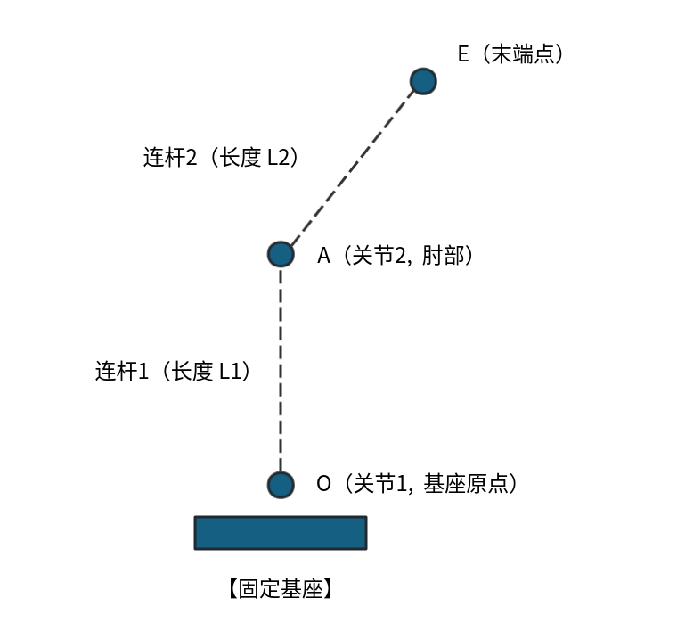

本文介绍机器人运动学建模的两种方法：标准DH（Standard Denavit-Hartenberg，SDH）、改进DH（Modified Denavit-Hartenberg，MDH）。
# 一、公垂线
1）公垂线（common perpendicular） 

对于空间中的两条直线，公垂线同时垂直于这两条直线，且与这两条直线相交。对于两条空间直线 L1和 L2，公垂线是一条直线 L，满足：

- L ⊥ L1：公垂线垂直于第一条轴线
- L ⊥ L2：​公垂线垂直于第二条轴线
- L 与 L1 相交于一点，与 L2​ 相交于另一点

2）公垂线长度：公垂线与两直线的交点之间的线段，就是公垂线的长度，也是两条直线间的最短距离线段。

3）公垂线必定存在：在三维空间中，任意两条直线都至少存在一条公垂线。

4）公垂线计算：对于空间中两条直线 $\vec{a}$、$\vec{b}$，公垂线为 $\vec{a} \times \vec{b}$，计算公式如下：
$$
\vec{a} \times \vec{b}
=
\begin{vmatrix}
\mathbf{i} & \mathbf{j} & \mathbf{k} \\
a_x & a_y & a_z \\
b_x & b_y & b_z
\end{vmatrix}
=
\begin{bmatrix}
a_y b_z - a_z b_y \\
a_z b_x - a_x b_z \\
a_x b_y - a_y b_x
\end{bmatrix}
$$

# 二、DH参数
DH（SDH 和 MDH）参数用 4 个参数描述相邻两个关节坐标系之间的相对位姿。本章对 SDH 和 MDH 作详细介绍。

## 1、SDH
SDH 建立坐标系过程如下：
- 确定所有Z轴：对于关节$i$，$Z_{i-1}$ 轴沿关节 $i$ 的轴线方向，即关节$i$对应坐标系$\{ i-1 \}$；
- 确定坐标系原点：坐标系$\{ i \}$的原点定在连杆 $i$ 的远端（即 $Z_i$​ 轴上），通常为 $Z_{i−1}$​ 与 $Z_i$​ 的公垂线与 $Z_i$​ 的交点；
- 确定所有X轴：$X_i​$轴沿$Z_{i−1}$与$Z_i$​ 的公垂线方向；
- 确定所有Y轴：$Y_i$轴由右手定则确定；
- 确定参数

对于关节 $i$，确定参数过程如表所示：

| 参数 | 符号 | 标准DH | 关节类型影响 |
| :---: | :---: | :---: | :---: |
| 连杆长度 | $a_i$ | 沿 $X_i$ 轴，从 $Z_{i-1}$ 到 $Z_i$​ 的距离 | 常数 |
| 连杆扭转角 | $\alpha_i$ | 绕 $X_i$ 轴，从 $Z_{i-1}$​ 转到 $Z_i$ 的角度（2D中全为0） | 常数 |
| 连杆偏距 | $d_i$ | 沿 $Z_{i-1}$ 轴，从 $X_{i-1}$​ 到 $X_i$​ 的距离（2D中全为0） | 移动关节时为变量 |
| 关节角 | $\theta_i$ | 绕 $Z_{i-1}$​ 轴，从 $X_{i-1}$​​ 转到 $X_i$​ 的角度 | 旋转关节时为变量 |

变换过程如下：
$$
{}^{i-1}T_i = \text{Rot}(Z_{i-1}, \theta_i) \cdot \text{Trans}(Z_{i-1}, d_i) \cdot \text{Trans}(X_i, a_i) \cdot \text{Rot}(X_i, \alpha_i)
$$
矩阵形式如下：
$$
\begin{equation}
{}^{i-1}T_i = 
\begin{bmatrix}
\cos\theta_i & -\sin\theta_i\cos\alpha_i & \sin\theta_i\sin\alpha_i & a_i\cos\theta_i \\
\sin\theta_i & \cos\theta_i\cos\alpha_i & -\cos\theta_i\sin\alpha_i & a_i\sin\theta_i \\
0 & \sin\alpha_i & \cos\alpha_i & d_i \\
0 & 0 & 0 & 1
\end{bmatrix}
\end{equation}
$$

## 2、MDH
MDH 建立坐标系过程如下：\
- 确定所有Z轴：$Z_i$轴沿关节$i$的轴线方向；\
- 确定坐标系原点：坐标系$\{ i \}$的原点定在$X_{i−1}$轴沿$Z_{i−1}$与$Z_i$的公垂线方向，坐标系$\{ i−1 \}$的原点位于该公垂线与$Z_{i−1}$的交点。该坐标系位于连杆 i 的起始端；\
- 确定所有X轴：$X_i​$轴沿$Z_{i−1}$与$Z_i$​ 的公垂线方向；\
- 确定所有Y轴：$Y_i$轴由右手定则确定；\
- 确定参数

对于关节 $i$，确定参数过程如表所示：

| 参数 | 符号 | 改进DH | 关节类型影响 |
| :---: | :---: | :---: | :---: |
| 连杆长度 | $a_i$ | 沿 $X_{i−1}$​ 轴，从 $Z_{i−1}$​ 平移到 $Z_i$​ 的距离 | 常数 |
| 连杆扭转角 | $\alpha_i$ | 绕 $X_{i−1}$​ 轴，从 $Z_{i−1}$​ 转到 $Z_i$​ 的角度 | 常数 |
| 连杆偏距 | $d_i$ | 沿 $Z_i$ 轴，从 $X_{i−1}$​ 平移到 $X_i$​ 的距离 | 移动关节时为变量 |
| 关节角 | $\theta_i$ | 绕 $Z_i$ 轴，从 $X_{i−1}$ 转到 $X_i$ 的角度 | 旋转关节时为变量 |

变换过程如下：
$$
{}^{i-1}T_i = \text{Rot}(X_{i-1}, \alpha_{i-1}) \cdot \text{Trans}(X_{i-1}, a_{i-1}) \cdot \text{Rot}(Z_i, \theta_i) \cdot \text{Trans}(Z_i, d_i)
$$
矩阵形式如下：
$$
\begin{equation}
{}^{i-1}T_i = 
\begin{bmatrix}
\cos\theta_i & -\sin\theta_i & 0 & a_{i-1} \\
\sin\theta_i\cos\alpha_{i-1} & \cos\theta_i\cos\alpha_{i-1} & -\sin\alpha_{i-1} & -d_i\sin\alpha_{i-1} \\
\sin\theta_i\sin\alpha_{i-1} & \cos\theta_i\sin\alpha_{i-1} & \cos\alpha_{i-1} & d_i\cos\alpha_{i-1} \\
0 & 0 & 0 & 1
\end{bmatrix}
\end{equation}
$$

# 三、例子
以 2D 机械臂为例介绍 SDH 和 MDH 建立的坐标系。2D 机械臂结构示意图如下：
 

$$
% 标准 DH (SDH) 变换公式
\begin{equation}

\end{equation}

% 改进 DH (MDH) 变换公式
\begin{equation}

\end{equation}

$$